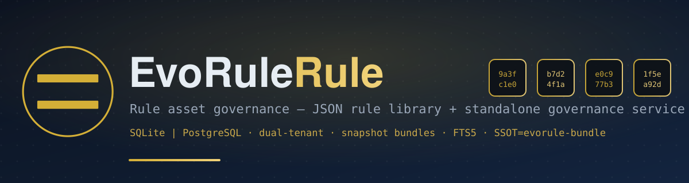

<!--
  Copyright 2026 EvoRule Project

  SPDX-License-Identifier: AGPL-3.0-or-later

  This file is part of EvoRule Rule, licensed under GNU Affero General Public License v3 or later.
-->



# EvoRule Rule

Rule asset governance layer: a JSON rule library plus a standalone governance service for storage, versioning, review, and audit.

[![CI][badge-ci]][ci-link]
[![License: AGPL-3.0-or-later][badge-license]][license-link]

**License**: [AGPL-3.0-or-later](LICENSE) with [dual licensing](DUAL_LICENSE.md)

The [evorule core repo](https://github.com/evorule/evorule) handles rule **execution** (TCB / reactor / governance); this repo handles rule **asset management** — datasets, entries, writeback events, and lifecycle — plus a standalone HTTP governance service and a CLI client. It does not replace the core engine; rules are ultimately executed there. Built for rule engineers who need versioned storage and approval workflows, platform admins who need multi-tenant isolation, and integrators who want to plug governance into their own frontend.

## Quick Start

1. **Build** (produces two binaries):

```bash
git clone https://github.com/evorule/evorule-rule.git
cd evorule-rule
cargo build --release
```

| Binary | Role |
|---|---|
| `evorule-rule-serve` | standalone governance service (REST API) |
| `evorule-rule-cli` | command-line client (pure REST, no direct DB connection) |

Both are also on [crates.io](https://crates.io/crates/evorule-rule): `cargo install evorule-rule --bin evorule-rule-serve` (or `--bin evorule-rule-cli`).

2. **Start the governance service**:

```bash
evorule-rule-serve --db ./data/rule.db --port 18081 \
    --admin-user admin --admin-password <your-admin-password> \
    --allowed-origins "http://localhost:5174"
```

First run auto-creates the default tenant/org and bootstraps the `platform_admin` account (idempotent); the JWT signing key is generated and persisted in the same directory — restarts preserve token validity and the key is never printed to logs.

3. **Log in for a token**:

```bash
curl -X POST http://127.0.0.1:18081/v1/auth/login \
  -H "Content-Type: application/json" \
  -d '{"username": "admin", "password": "<your-admin-password>"}'
```

4. **Use the CLI** (auth via the `EVORULE_RULE_URL` / `EVORULE_RULE_TOKEN` environment variables):

```bash
evorule-rule-cli datasets list
evorule-rule-cli datasets export ds-tax-2024 --out bundle.json
evorule-rule-cli datasets import bundle.json
```

CLI import goes through the same validation chain as `/v1/bundles/import` — one SSOT caliber across API and admission gate.

## Usage

The API lives under `/v1` (50+ routes), grouped by functional domain:

| Domain | Representative endpoints |
|---|---|
| Auth | `POST /v1/auth/register` `/login` `/refresh` `/logout` · `GET /me` — Bearer token + jti blacklist revocation |
| Orgs & tenants | `/v1/orgs` family — platform/org dual-layer tenants, five roles |
| Datasets | CRUD · `POST /{id}/publish` · versions / metadata / event schema — five-state lifecycle, publish confirmation, tenant isolation |
| Entries | `/v1/datasets/{id}/entries?filter=` · `/v1/entries/{id}` — server-side filtering, submit-candidate / approve, per-version payload, content diff |
| Snapshot packages | `POST /v1/bundles/export` `/import` — export / trim / import / dry-run, historical-version export |
| Search | `GET /v1/search/datasets` `/search/entries` — cursor-paginated; entries FTS5 trigram full-text |
| LLM | `POST /v1/llm/ops/{operation}` — proxied to evo-agent, operation-level audit, honest unreachability reporting |
| Ops | `GET /v1/health` (no-auth, anti-info-leak) · `GET /v1/admin/backend` — active storage engine self-check |

Cross-cutting: an `Idempotency-Key` middleware and full-chain audit queries (auth / lifecycle / llm).

Core capabilities:

- **Dataset & entry governance** — seven data models, five-state lifecycle with publish confirmation, tenant isolation
- **Version management** — persisted version snapshots, per-version payload endpoints, historical bundle export
- **Snapshot package exchange** — the validation chain's SSOT is [evorule-bundle](https://crates.io/crates/evorule-bundle), shared with the execution side
- **Content addressing** — entry content-hash snapshots, dedup stats, content-level diff
- **Query & search** — server-side `?filter=` expressions plus FTS5 trigram full-text
- **Auth & keys** — JWT dual-generation rotation, jti blacklist, API key issuance/revocation
- **LLM named operations** — proxied execution with operation-level audit; unreachability is reported honestly, never fabricated

## Configuration: dual storage backends

| | SQLite (default) | PostgreSQL (optional) |
|---|---|---|
| Enable | zero config | `--features postgres` compile-gated + `DATABASE_URL` |
| Positioning | MVP / dev / single machine | production-grade |
| Startup | opens directly | smoke-probe gated (pool + migrations + minimal CRUD round-trip); on failure falls back gracefully to SQLite, never faked |
| Self-check | — | `GET /v1/admin/backend` reports the active backend + probe results |

The PostgreSQL dependency never drags down the default build.

## Documentation

Organized per [Diátaxis](https://diataxis.fr/): [docs/introduction.md](docs/introduction.md) is the entry point, [docs/SUMMARY.md](docs/SUMMARY.md) the full map (`mdbook serve docs` for a local book).

## Roadmap

- Next: data-source binding contract validation (coordinated with evorule-server) · LLM service integration through evo-agent
- Later: performance baseline · white-label + Dockerization

Authoritative status: [CHANGELOG](CHANGELOG.md).

## Contributing

PRs go through standard review; contributions are covered by the project's contribution license agreement — see [CLA-individual.md](CLA-individual.md) / [CLA-corporate.md](CLA-corporate.md).

## Security

Security issues go through the private disclosure channel in [SECURITY.md](SECURITY.md).

## License

**AGPL-3.0-or-later** (unified across the ecosystem), consistent with the core repo. Dual licensing applies: closed-source use — see [DUAL_LICENSE.md](DUAL_LICENSE.md), [FREE_COMMERCIAL_LICENSE.md](FREE_COMMERCIAL_LICENSE.md) (free waiver for eligible entities), or [COMMERCIAL_LICENSE.md](COMMERCIAL_LICENSE.md). The constitution `core_eval.json` is CC0-1.0. Commercial inquiries: <evorulelab@gmail.com>.

[badge-ci]: https://github.com/evorule/evorule-rule/actions/workflows/ci.yml/badge.svg
[ci-link]: https://github.com/evorule/evorule-rule/actions/workflows/ci.yml
[badge-license]: https://img.shields.io/badge/license-AGPL--3.0--or--later-blue?style=flat-square
[license-link]: LICENSE
